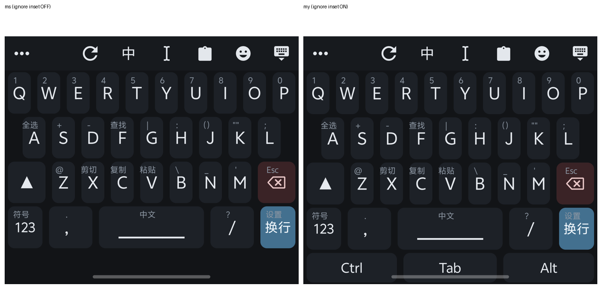

基于 [墨奇音形](https://github.com/gaboolic/rime-shuangpin-fuzhuma)（作者 gaboolic）的个人配置

在原版基础上主要补的是**选词控制**：让「哪个词占哪个码、谁排前面」由你写死，而不是由算法猜。

为此加了两张表，另外沿用原版已有的一张：

- `custom_phrase/custom_short.txt` —— **自定义编码**，配套 `moqi.yaml:82` 的 `table_translator@custom_short`
- `custom_phrase/custom_extend.txt` —— **加词与调词频**，配套 `moqi_wan.extended.dict.yaml:33` 的一行导入
- `custom_phrase/custom_phrase.txt` —— 原版已有的最高一档固定表，本版也用它

## 一、三张表，各管一段

| 文件                                | 来源     | 档位                       | 干什么                             | 参与双拼辅码/长句 |
| :-------------------------------- | :----- | :----------------------- | :------------------------------ | :-------- |
| `custom_phrase/custom_short.txt`  | **新增** | `50000`                  | **自定义编码**：以三、四简码为主 | ✗         |
| `custom_phrase/custom_extend.txt` | **新增** | 主表 `10000` + 词条 `500000` | **加词与调词频**：正常参与双拼、辅码、长句         | ✓         |
| `custom_phrase/custom_phrase.txt` | 原版已有   | `100000`                 | **最高一档**：固定「这个码就出这个词」 | ✗         |

三张表都**不学习、不上浮**：同一串输入永远同一顺序。

### `custom_short.txt`：以指定编码打出任意字符

- 一行一条：`词<Tab>你指定的码`（可选第三列权重），`#` 开头是注释；
- 公开版只放了几条示例，**需要自己在长期使用中积累**：单字词频、二三四简码、缩写打全称，都可以塞进来；
- **不参与辅码和长句**，只按你写的码出词，所以便宜（`50000`，排在系统词前面）；
- **参与反查**：用全码打出这个词，反查会告诉你能用哪个编码打。

```
中华人民	vhrm
中华人民共和国	vhrm
```

`vhrm` + 空格 →「中华人民」；`vhrm` + `；`（次选）→「中华人民共和国」

> 大写开头的码只能用空格选第一条（`Ds`、`Da` 这些），数字键 / `；` / `'` 都选不中，原因和绕法见「五 · 11）」。

### `custom_extend.txt`：能加词、能调频，跟着主词表走

- 一行一条，字段用 **Tab** 分隔：

  ```
  词                                自动生成辅助码，权重 500000
  词<Tab>600000                     自动生成辅助码，指定权重（数字越大越靠前）
  码长<Tab>ma;um; chang;pn;<Tab>500000   手动指定读音（多音字读错时用）
  ```

- **只管写词**，辅码由脚本按墨奇码表生成；**脚本目前只生成墨奇辅助码**，换别的辅助码方案要改脚本
- 改完跑一次 `python Rime词库管理.py` 生成 `cn_dicts_common/custom_extend.dict.yaml`，再重新部署
- 若多音字读音不理想，可从 `cn_dicts_common/custom_extend.dict.yaml` 复制一条过来改掉读音
- **别往里放单字**：一条 `500000` 会把那个字顶到同音字第一位并锁死顺序，整句选字都会受影响

### `custom_phrase.txt`：最高一档

写进去就是第一位，**不用加权重**（同一码上有多条时才靠第三列排序）。
本版除个人信息外，还用它承担**让二字词压过四简码**这件事。

```
是	u	3
什么	u	2
是不是	u	1
```

想往 `u` 上加一条，可能要把这三条的权重一起重排；同样的词放进 `custom_short.txt` 就不用动它们——那里天然低一档，只在本文件内调相对顺序即可。

## 二、加词放哪张表

| 情况                                  | 放哪                                              | 说明                              |
| :---------------------------------- | :---------------------------------------------- | :------------------------------ |
| 系统里根本没有自己的词（双拼、辅码、长句都打不出）          | `custom_extend.txt`                             | 加进去就能用双拼形辅打出，也能进长句              |
| 系统里有，只是对它的词频不满意                     | `custom_extend.txt`                             | 正常参与双拼、辅码、长句，只把它的顺序提前           |
| 二字词与四简码重码                           | `custom_phrase.txt`，词频高于 `custom_short.txt` 里的四简码 | 出简让二字词；代价见「三 · 4）」             |
| 想用自定编码打（简码、缩写、冷门字补回）               | `custom_short.txt`                              | 只按你写的码出词；写到五码以上会顶屏，见「三 · 2）」 |

系统没有的词，想用双拼打就 `custom_extend.txt`，想用简码打就 `custom_short.txt`——两张表职责不同，都重要

## 三、限制

### 1）候选顺序

| 顺序  | 来源                         | 基础质量                   |
| :-: | :------------------------- | :--------------------- |
|  1  | `custom_phrase.txt`        | `100000`               |
|  2  | `custom_short.txt`         | `50000`                |
|  3  | `custom_extend.txt`（并入主词表） | 主表 `10000`，词条 `500000` |
|  4  | 系统词                        | `10000` + 各词自带词频       |
|  5  | 简码/快符/字根等让位表               | `-1`                   |

- **跨词库抢第一靠"换档"，不是把权重写大**：同一个码在两个文件里都有时，上面那档赢；
- **同一档内部才比权重**：写 `假期<Tab>500001` 就比同文件默认的 `500000` 靠前。

### 2）五码及以上的自定义编码会顶屏

顶屏不是「打完四码就自动上屏」，而是：候选第一位已经定了，**接着往下打别的字母**时，那一位直接上屏（省掉一个空格），剩下的键留着继续输入。但该方案容易影响打长句

`custom_short.txt` 若加入
```
链接	lmjpf       ← 在 custom_short.txt 里
```

想打 `lm jp fu` 「连接符」，打 `lmjpf`，第一候选是「链接」再打 `u`，「链接」就上屏了，候选里只剩一个 `u`。所以：**自定义编码别写到五码以上**，用四码打多字即可

不过完全无重码的，比如：
```
λ	lambda
```

打 `lambda` 之后再打字同样会顶屏 `λ`，就无所谓

### 3）加词会影响长句排序

`custom_extend.txt` 用得越多，长句排序越受它影响。想让「歧视」在 `qi ui` 里排第一，写进 extend 可以做到，
但 `hd xk qi ui` 的候选会变成「还行歧视」；给那个音节补个辅码回来 `hd xk qi uib` →「还行其实」，或者干脆
```
还行其实	hxqu
```

### 4）简码不分音节

`custom_short.txt` 和 `custom_phrase.txt` 里的码不带音节边界，方案没法把它拆回两个音。停在候选上时：

- 不能按音移动
- 不能用 Shift 加辅码
- 不参与长句

这是简码的代价，——想要可移动、可补辅码，就用 `custom_extend.txt`

### 5）删掉的两个读音

`yai`（崖、厓、睚、啀、嘊、崕、娾 这一族的另一种读音）和 `dia`（嗲）都是**单音节**——双拼只占两个字母（`yd`、`dx`）。
一个字挂上它，就会把 `ydky`（一定可以）这类四简码压在下面。

原版本来四简码就不少，只是权重偏低，还得再往 `custom_short.txt` 里抄一遍把它们提前；`yd`、`dx` 更糟，
会被带「厓」「嗲」的那几个冷门词盖住。**对几乎用不上、或只对应一两个生僻字的读音，删掉改用自定义编码更划算**：
不用再往 `custom_short.txt` 里加一遍，删掉的字和带它的词也照样能打。

所以删掉了单字的 `yai`（啀 嘊 娾 崕 崖 睚 厓）和 `dia`（嗲）；**带这些音的词保留**（`发嗲`、`嗲嗲兔` 之类照样能打）。
`崖`、`睚` 仍有 `ya` 读音，`啀`、`嘊`、`娾` 仍有 `ai`，用起来没差别。

`嗲` 在自定义编码里补上，既能正常打出，又不占四简码的位：
```
嗲	dx
嗲	dxk
嗲	dxkx
嗲	dxkx/
```

## 四、改完怎么生效（Windows / 安卓）

分两档：**词表 txt 与同文主题 `ms.trime.yaml`** 只要重启引擎；**方案 yaml、`symbols_caps_v.yaml`、`lua/`** 才要重新部署——重建 `build/` 是慢的那一步。

| 改了什么                                                                 | 怎么生效                                     |
| :------------------------------------------------------------------- | :--------------------------------------- |
| 词表 txt：`custom_short.txt`、`custom_phrase.txt`、`custom_phrase_kf.txt` | 同文：工具栏 ⟳「同步」；小狼毫：重启算法服务                  |
| `custom_extend.txt`                                                  | 先跑脚本生成 `custom_extend.dict.yaml`，再「重新部署」 |
| 主题 `ms.trime.yaml`（仅同文）                                              | 同文：⟳「同步」                                 |
| 其他 yaml：方案（`moqi.yaml` 等）、`symbols_caps_v.yaml`、`lua/`               | 两端都要「重新部署」                               |

词表 txt 是运行时读的，不重建 `build/`：安卓按一下键盘工具栏的 ⟳（同步），Windows 重启算法服务即可。
同文的「同步」会把 `/storage/emulated/0/rime` 的改动搬进私有目录，再合并 `sync/<设备id>/` 下的词库快照，然后重启引擎——PC 经 Syncthing 同步过来的改动就是靠它。

`custom_extend.txt` 要先生成词典：

```powershell
cd $env:APPDATA\Rime
python Rime词库管理.py
```

脚本依赖 `pypinyin`（`pip install pypinyin`）。没装不会报错，而是把每个字本身当读音，生成的词典不可用；txt 不会被改坏，装上再跑一遍即可。

改 yaml / lua 才需要重新部署：同文是设置页 → **↺ 重新部署**（工具栏 ⟳ 不重建 `build/`），小狼毫是 `WeaselDeployer.exe /deploy` 后重启 `WeaselServer.exe`。

## 五、其他改动

### 1）引导前缀：`a*` → `Z*`

原版用 `a` 开头的组合做引导，这一版统一改成大写 `Z`，避免影响简拼

| 功能 | 原版 | 本版 |
| :-- | :-- | :-- |
| 墨奇码反查 | `amq` | `Zmq` |
| 仓颉反查 | `arj` | `Zcj` |
| 笔画反查 | `ab` | `Zb` |
| 自然两分 | `alf` | `Zlf` |
| 拆字组字 | `az` | `Zz` |
| Emoji | `ae` | `Ze` |
| 英文 | `aw` | `Zw` |
| 日语 | `aj` | `Zj` |
| 自造词 | `ac` | `Zcy` |

自造词用三位 `Zcy`：两位的 `Zc` 会把 `Zcj`（仓颉）吃掉

### 2）补回 `cangjie5.schema.yaml`

上游只有 `cangjie5.dict.yaml`，没有配套的 `cangjie5.schema.yaml`，缺了它编译不出仓颉词典。
电脑端可能因为 `build/` 里有旧产物而看不出问题，手机重新部署后 `Zcj` 就直接打不出。本版把这个 schema 补回。

### 3）推荐自定义的位置

| 文件                                   | 用途                                        |
| :----------------------------------- | :---------------------------------------- |
| `custom_phrase/custom_short.txt`     | 用指定的 ASCII 编码打出指定的任意字符或词                  |
| `custom_phrase/custom_extend.txt`    | 加词与调词频，正常参与双拼、辅码、长句                       |
| `custom_phrase/custom_phrase.txt`    | 个人信息等固定条目，让二字词压过四简码                       |
| `symbols_caps_v.yaml`                | 斜杠引导的符号与个人信息，缓解 `custom_phrase.txt` 的重码压力 |
| `custom_phrase/custom_phrase_kf.txt` | `o` 引导的符号与表情，减少手指位移                       |

前三个文件的用法见前面几节；后两个是"引导型"的表，按 `码<Tab>内容` 往里加即可

### 4）Lua 与其他功能

| 文件 / 功能                            | 作用                                                                                                                                                 |
| :--------------------------------- | :------------------------------------------------------------------------------------------------------------------------------------------------- |
| `lua/aux_shift.lua`                | 让同文支持 **▲ + 字母** 给第一个音节补辅码（原本会先合成大写字母）                                                                                                             |
| `lua/commit_comment.lua`           | Ctrl+J 把候选的注释直接上屏（反查结果上屏）                                                                                                                          |
| `lua/charset_filter.lua`           | 大小字集开关（工具栏/开关里的「小」字集过滤）                                                                                                                            |
| `lua/moqi/jianma_show.lua`         | 反查一二三简码、超级简拼和 `custom_short.txt`；改词表不用再手动动 `jian.dict.yaml`                                                                                        |
| `lua/shift_enter.lua`              | 同文 **▲ + Enter** 输出 `<br>`，在 Obsidian 表格里换行                                                                                                        |
| `super4.dict.yaml` + `生成super4.py` | 四简码反查。原版四简码与 e 简码有交叉，反查也混乱，这里不用 e 简码、统一给四简码做反查；四简码条目太多，塞进 `jianma_show.lua` 会拖慢，所以单独一张表。一般建议直接加进 `custom_short.txt` 即可，若要修改可以使用 `生成super4.py` 重新生成 |
| 单引号三选                              | 单引号键上屏候选第三                                                                                                                                         |
| 逗号上屏超级简拼                           | 逗号键上屏超级简拼                                                                                                                                          |
| 关掉语言模型                             | 实现完全固定的词频                                                                                                                                          |
日期时间别名
- date 别名 `Da`
- time 别名 `Uj`
- datetime 别名 `DT`
- week 别名 `Wk`
- timestamp 别名 `Ts`
- `Dt` 不带秒的 datetime

### 5）同文手势（`ms.trime.yaml`）
键面上那两行小字就是触发提示：**上面一行是符号小字**（`label_symbol`），**下面一行是注解小字**（`hint`）。

**Q–P：下滑**

| 键   | 动作            | 预设                                |
| :-- | :------------ | :-------------------------------- |
| Q   | 打开 QQ         | `AppQQ`（`command: run`）           |
| W   | 打开微信          | `AppWeChat`                       |
| E   | Ctrl+E 翻译     | `CtrlE`（`send: Control+e`）        |
| R   | 重复上屏刚打出的内容    | `RepeatCommit`（`command: commit`） |
| T   | 插入当前日期时间（不含秒） | `Timestamp`（`command: date`）      |
| O   | 打开 Obsidian   | `AppObsidian`                     |
| P   | Ctrl+P 首末拆分   | `CtrlP`（`send: Control+p`）        |

**A–L**

| 键   | 手势    | 动作                           | 预设                               |
| :-- | :---- | :--------------------------- | :------------------------------- |
| A   | 长按/上滑 | 全选                           | `select_all`                     |
| S   | 下滑    | 保存（Ctrl+S）                   | `CtrlS`（`send: Control+s`）       |
| D   | 下滑    | 打开抖音                         | `AppDouyin`                      |
| D   | 左滑    | Ctrl+D                       | `CtrlD`                          |
| F   | 长按/上滑 | 查找（Ctrl+F）                   | `CtrlF`                          |
| F   | 下滑    | 用必应搜索光标前的内容                  | `Bing`（`option` 里 `%4$s` 是光标前文本） |
| H   | 左滑    | 收起/展开符号小字                    | `HideSymbols`                    |
| H   | 下滑    | 收起/展开注解小字                    | `HideHints`                      |
| J   | 长按/上滑 | 成对括号（中文态 `（）`、英文态 `()`），光标居中 | ASCII 字面量 `(){Left}`             |
| J   | 下滑    | 上屏反查（Ctrl+J）                 | `CtrlJ`                          |
| L   | 长按/上滑 | 分号 `;`，可上屏次选                 | —                                |
| L   | 下滑    | 墨奇拆字（Ctrl+L）                 | `CtrlL`                          |

**Z–M**

| 键   | 手势    | 动作                 | 预设                                                 |
| :-- | :---- | :----------------- | :------------------------------------------------- |
| X   | 长按/上滑 | 剪切                 | `cut`                                              |
| C   | 长按/上滑 | 复制                 | `copy`                                             |
| V   | 长按/上滑 | 同文剪贴板直贴（不依赖 App）   | `paste_clip`                                       |
| V   | 下滑    | 系统剪贴板粘贴（等同 Ctrl+V） | `paste`                                            |
| B   | 下滑    | 加粗（Ctrl+B）         | `CtrlB`                                            |
| N   | 下滑    | 新建（Ctrl+N）         | `CtrlN`                                            |
| M   | 长按/上滑 | 单引号 `'`，可上屏候选第三    | —                                                  |
| M   | 下滑    | 打开 MT 管理器          | `MT_manager`（`command: run`，`option: bin.mt.plus`） |

**其他**

| 键 | 手势 | 动作 |
| :-- | :-- | :-- |
| ▲ | 单击 | 一次性大写（`Shift_L`） |
| ▲ | 双击 / 上滑 | 锁定大写（`Shift_L3`） |
| ▲ | 按住 + Enter | 输出 `<br>`（`lua/shift_enter.lua`） |
| ⌫ | 上滑 | Esc（`Escape`） |
| ⌫ | 下滑 | 撤销（`undo`） |
| ⌫ | 按住左右滑 | 逐字删（`slide_delete`，预设自带） |
| 空格 | 按住左右滑 | 移动光标（`slide_cursor`） |
| 空格 | 长按 / 上滑 | 切换中英文（`Mode_switch`） |
| 123 | 上滑 | 符号区（`Symbols_panel`） |
| Enter | 上滑 | 同文设置（`Settings`） |

**长按弹条**（`popup`）

| 键 | 弹条 |
| :-- | :-- |
| 123 | 符号（`Symbols_panel`）→ 换皮肤（`Color_switch`）→ 主题（`Theme_settings`） |
| Enter | 同文设置（`Settings`）→ 系统设置（`SysSettings`）→ 开发者选项（`DevSettings`） |

> 弹条是"离手指最近的那项排第一，其余往另一侧排"：Enter 在右边缘，所以往左依次是系统设置、开发者选项

**长按逗号 → 系统的「输入法」页**

直接跳转：预设 `IMESettings` 的 `option` 写死成
`com.android.settings/.Settings$InputMethodAndLanguageSettingsActivity`。

> ⚠️ 组件名是按 OriginOS 写的，别的 ROM 上通常不一样；而不存在时同文不会安静地失败——
> 它会抛 `ActivityNotFoundException`，直接弹「应用程序崩溃了」的崩溃日志页。换机器前先查自己的：
>
> ```
> adb shell cmd package resolve-activity -a android.settings.INPUT_METHOD_SETTINGS
> ```
>
> 把输出里的 `name=` 和 `packageName=` 拼成 `包名/组件名` 填回 `option` 就行。
>
> 同一个坑的另一半：**应用没装也会这样崩**。Q、W、O、D 那几下是 `command: run` 拉起对应 App，没装就一样抛这个异常。装 App 或改掉即可

### 6）工具栏按钮
工具行从左到右：

| 按钮   | 图标                                 | 动作                                                         |
| :--- | :--------------------------------- | :--------------------------------------------------------- |
| ⋯ 菜单 | `ic@dots_horizontal`               | 打开菜单（键盘样式 / 方案 / 更新配置 / 虚拟键盘…），固定在最左，配置项是 `primary_button` |
| ↻同步  | `ic@refresh`（`sync_button`）        | 搬外部存储改动 + 合并词库快照 + 重启引擎（`Sync`）                            |
| 中/En | `ascii_mode_button`                | 切换中英文（`Mode_switch`），按状态显示「中」/「En」                         |
| 光标   | `ic@cursor_text`（`move_button`）    | 切到 Move 区（`Keyboard_move`）                                 |
| 剪贴板  | `ic@clipboard`（`clipboard_button`） | 打开同文剪贴板                                                    |
| 表情   | `ic@emoticon`（`emoji_button`）      | 打开表情/符号面板                                                  |
| 收起   | `ic@keyboard_close`（`hide_button`） | 收起键盘                                                       |

### 7）Move 区（光标区）
|  全选  |   文首   |    ↑     |   文末   |    粘贴    |
| :--: | :----: | :------: | :----: | :------: |
|  剪切  | ⇐<br>← |    选择    | ⇒<br>→ | 删词<br>删除 |
|  复制  |  Home  |    ↓     |  End   | 删词<br>⌫  |
| Ctrl |   撤销   | Tab<br>␣ |   重做   |  Enter   |
|      |        |    返回    |        |          |

- 选择：按住 Shift（`Shift_L2`）
- ⇐ / ⇒：Ctrl+← / Ctrl+→ 跳词（`Left1` / `Right1`）
- 删词：⌫ 是 Ctrl+Backspace（`CtrlBackspace`），删除键是 Ctrl+Delete（`DeleteCandidate`）
- 重做：Ctrl+Shift+Z（`redo`）
- 空格：点按出空格，长按/上滑出 Tab（`space_tab`）
- 返回：底部**整行一个键**（`Keyboard_default`），点一下回到魔裁的字母键盘

### 8）全键布局（`my.trime.yaml`）
仓库里有两份主题：`ms.trime.yaml`（魔裁），`my.trime.yaml`（全键）在它基础上多一排修饰键（`Ctrl` / `Tab` / `Alt`），需要组合键时可以切过去用

`my.trime.yaml` 由 `生成my布局.py` 从 `ms.trime.yaml` 生成：
```bash
python 生成my布局.py
```

要动全键的布局，改脚本（或 `ms.trime.yaml`）后重跑即可，别直接改 `my.trime.yaml`——下次生成会覆盖



魔裁不忽略（左）全键忽略（右）
同文设置 → 高级 → 忽略系统手势边衬区，开启则会忽略掉与系统按钮的间隔使按键贴底

借此可实现两种主题保持字母坐标不变，让全键在底部多出一排修饰键。但不同设备 DPI 不同，推荐根据自己的设备进行调整

### 9）Enter 文案
Enter 的标签由 `style.enter_labels` 决定，按 App 上报的输入动作取：

| 动作 | 文案 | 场景 |
| :-- | :-- | :-- |
| `go` | 前往 | 浏览器地址栏 |
| `search` | 搜索 | 应用内搜索框 |
| `send` | 发送 | 短信 / 邮件 |
| `next` | 下个 | 表单下一项 |
| `pre` | 上个 | 表单上一项 |
| `done` | 完成 | 单行输入结尾 |
| `default` | 换行 | 多行文本、正文编辑器 |

`enter_label_mode: 0`（只用自己的表）。有候选时 Enter 显示「确定」（`composing: Return1`）。

### 10）一些同文小技巧
空格左右滑（`slide_cursor`）发出去的就是 ← / →，
所以在全键上先锁修饰键再滑，等于把方向键搬到了主键盘，不用进 Move 区：

| 手势                       | 等价于                         |
| :----------------------- | :-------------------------- |
| 锁 `Ctrl` + 空格左右滑         | `Ctrl+←` / `Ctrl+→`，编辑器里按词跳 |
| 锁 `Shift` + 空格左右滑        | 选中文字（再叠 `Ctrl` 就是按词选）       |
| 锁 `Ctrl` + `Alt` + 空格左右滑 | `Ctrl+Alt+←` / `Ctrl+Alt+→` |

带修饰位的同文都能发，`Ctrl` / `Shift` / `Alt` / `Win` 都行，只有两个要注意：

| 修饰键     | 限制                                                         |
| :------ | :--------------------------------------------------------- |
| `Shift` | 中文态下，只有「带 Shift + 字母或可上档符号」同时成立时才失效，切英文态可用；方向键没有上档操作所以不受影响 |
| `Win`   | 可能要先切英文态                                                   |

**`Shift` + 空格**（▲ + 空格）在手机上很好按，适合给 Obsidian 这类跨平台应用设一个高频快捷键

### 11）大写开头的码：数字、分号、单引号都选不中
`custom_short.txt` 里大写开头的短码用着很舒服：码短、跟正常打字不重码、不用记大小写也不会拼错
（`Ds` → DeepSeek / DeepSeek Harness）。

但候选只能用**空格**上屏。输入还停在「大写字母」状态时，上排数字键、`；`（次选）、`'`（三选）全部失效——
按下去只是把那个字符打进去。原因是大写字母还得能跟数字组合（`N` 日期、`R` 大写金额这类功能靠它），
输入法分不清你是要选第 2 个候选，还是要打一个 2。

`Z*` 引导、日期时间别名（`Da` / `Uj` / `DT` / `Wk` / `Ts` / `Dt`）都是大写开头，同样只能空格上屏。

三种应付办法：

| 情况                 | 办法                                             |
| :----------------- | :--------------------------------------------- |
| 想要的排在第二、第三         | 再给它加一码顶到第一（例如 `Dsh` → `DeepSeek Harness`），空格上屏 |
| 加不了码（`Z*` 引导、日期别名） | 先用 ↓ 把选中项挪到它，再空格                               |
| 第一位就是想要的           | 直接空格                                           |

## 六、鸣谢
- [墨奇音形](https://github.com/gaboolic/rime-shuangpin-fuzhuma) 作者 gaboolic —— 本配置全部基于它修改
- [薄荷输入法](https://github.com/Mintimate/oh-my-rime) —— 小狼毫「蓝水鸭」皮肤
- [魔裁 ms-trime](https://github.com/lost-42/ms-trime) —— 安卓端布局
- [白霜词库](https://github.com/gaboolic/rime-frost) / [雾凇拼音](https://github.com/iDvel/rime-ice) —— 词库与词频来源
- [同文 Trime](https://github.com/osfans/trime) —— 安卓端输入法平台
- [小狼毫 Weasel](https://github.com/rime/weasel) —— Windows 端输入法平台
